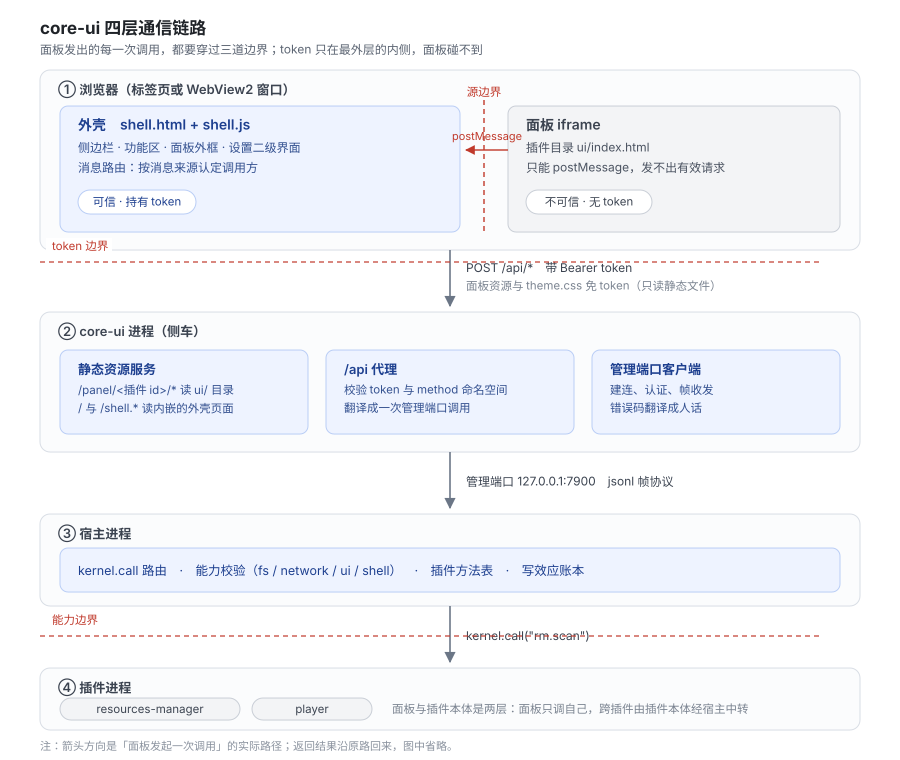

# core-ui 03 架构设计

> 状态：初定 | 版本：1.1.0-b1 | 最后更新：2026-11-02
> 依据：`docs/ling/builtin-plugins/core-ui/02-技术选型.md`

本文回答：core-ui 分成哪几块、各块怎么配合、信任边界画在哪、状态存在哪。

---

## 1. 分四块

| 层 | 跑在哪 | 是什么 | 可信度 |
|---|---|---|---|
| **外壳** | 浏览器（或 WebView2）里的一个文档 | 侧边栏、功能区、面板外框、设置二级界面。持有 token | 可信 |
| **面板** | 同一个浏览器里的 iframe | 插件自己写的网页 | 不可信 |
| **服务端** | `core-ui` 进程 | 发外壳页面与面板资源；把 `/api/*` 转成管理端口调用 | 可信 |
| **宿主适配** | `core-ui` 进程内的一小段 | 管理端口客户端：建连、认证、帧收发、错误码翻译 | 可信 |

插件本体（提供面板的那个插件）不在这四块里：它跑在自己的进程，core-ui 只经宿主间接调用它。

## 2. 全景图



图中三条竖线是三道边界，从外到内：

| 边界 | 在哪两个东西之间 | 靠什么守住 |
|---|---|---|
| 源边界 | 外壳 ↔ 面板 | iframe `sandbox` 不授予同源；面板读不到外壳存储，也发不出有效请求 |
| token 边界 | 浏览器 ↔ 服务端 | 所有 `/api/*` 校验 bearer token；面板资源与主题样式表例外 |
| 能力边界 | 宿主 ↔ 插件 | 插件调每个方法都要过能力校验与命名空间校验 |

面板发出的每一条调用都要穿过三道边界：源边界只能走 `postMessage`，token 边界由外壳代持，能力边界由服务端与宿主二次校验。这条链是 1.1.0 全部安全设计的骨架。

## 3. 外壳

### 3.1 由什么组成

| 文件 | 职责 | 大小量级 |
|---|---|---|
| `shell.html` | 骨架：侧边栏容器、功能区容器、设置容器 | 100 行以内 |
| `shell.css` | 布局与令牌引用，不写死颜色 | 400 行 |
| `shell.js` | 导航、初始化、设置页挂载 | 600 行 |
| `panels.js` | 面板管理（增删、宽度、恢复）与消息路由 | 400 行 |
| `theme.js` | 主题应用、`theme.css` 拉取、切换广播 | 120 行 |
| `views/*.js` | 六个管理页签，各自一个文件 | 每个 150 至 400 行 |

外壳是**单页应用**：所有切换在同一文档内完成，不刷新。理由是刷新会丢掉所有已打开面板的状态。

### 3.2 三个职责

| 职责 | 具体做什么 |
|---|---|
| 渲染 | 侧边栏按插件列表生成入口；功能区按打开集合生成面板与外框；设置按页签切换 |
| 消息路由 | 收面板的 `call`，校验命名空间，代发请求，把结果回给该面板；向所有面板广播 `theme` 与 `event` |
| 状态管理 | 维护「哪些面板开着」「每个多宽」「侧边栏收没收起」，写回 `core-settings` |

### 3.3 不做什么

外壳不解析插件的业务数据。`rm.scan` 返回什么结构、面板怎么渲染，外壳不关心，只做原样转发。这条让外壳不必随插件升级而改动。

## 4. 面板

### 4.1 一份网页

面板就是一个 HTML 文档，通常带自己的 CSS 与 JS。它可以拆成任意多个文件，放在插件目录的 `ui/` 下：

```
plugins/resources-manager/
├─ plugin.toml          [ui] entry = "ui/index.html"
└─ ui/
   ├─ index.html
   ├─ style.css
   └─ app.js
```

### 4.2 与外界的唯一接口

面板只能做三件事：

| 事 | 怎么做 |
|---|---|
| 收外壳消息 | `window.addEventListener("message", ...)` |
| 发调用请求 | `parent.postMessage({type:"call", ...}, "*")` |
| 取主题 | `<link rel="stylesheet" href="/api/ui/theme.css">` |

发消息的 `targetOrigin` 必须是 `"*"`：面板自己是不透明源，无法指定具体 origin。安全性不靠 `targetOrigin`，靠外壳那边校验 `event.source` 是不是某个已知 iframe 的 `contentWindow`（见 `docs/ling/builtin-plugins/core-ui/04-详细设计/03-面板挂载与消息协议.md` §4.1）。

## 5. 服务端

### 5.1 四类路由

| 路由 | 认证 | 谁用 |
|---|---|---|
| `GET /`、`GET /shell.*`、`GET /views/*` | 无 | 浏览器首次加载外壳 |
| `GET /panel/<插件 id>/*` | 无 | iframe 加载面板资源 |
| `GET /api/ui/theme.css` | 无 | 外壳与所有面板 |
| `POST /api/*` | bearer token | 外壳 |

前三类免认证，是因为浏览器加载文档、样式表与 iframe 里的资源时都无法带自定义请求头。它们只返回静态文件，不含任何秘密。涉及副作用的调用全部落在第四类。

### 5.2 一层薄代理

服务端不含业务逻辑：每个 `/api/<动作>` 都翻译成一次管理端口调用，与命令行走同一条路由（`LING-REQ-072`）。

```
POST /api/plugins  →  kernel.plugins  →  返回 JSON
POST /api/panel/call {plugin, method}  →  校验命名空间  →  kernel.call  →  返回 JSON
```

`/api/panel/call` 比 1.0.0 的 `/api/<动作>` 多一步：校验 `method` 的前缀等于 `plugin`。这一步是能力边界的第二道闸（第一道在外壳）。

## 6. 宿主适配

管理端口客户端只有四件事：建连与认证、请求与响应配对、错误码翻译、断线重连提示。

错误码分三类处理：

| 类别 | 例子 | 外壳怎么显示 |
|---|---|---|
| 用户能自己解决的 | 路径不存在、cron 写错 | 原样显示 `message` 与 `advice` |
| 需要看日志的 | 插件启动失败 | 显示原因，附「看日志」按钮 |
| 环境问题 | 宿主没响应 | 侧边栏底部状态变红，提示「ling 没有响应」 |

错误结构与文案沿用 `docs/ling/main/04-详细设计/04-管理端口与命令行.md` §4.4，界面不另写一份。

## 7. 四条关键数据流

### 7.1 打开一个面板

```
1. 外壳启动时 POST /api/panels     →  拿到带 [ui] 的插件列表
2. 侧边栏按列表生成入口（无面板的插件不出现）
3. 用户点入口
4. 外壳在功能区插入外框 + iframe src="/panel/<id>/<entry 去掉 ui/ 前缀>"
5. 浏览器请求资源 → 服务端读 <插件目录>/ui/ 下的文件
6. iframe load 事件 → 外壳 postMessage {type:"init", pluginId, theme, tokens}
7. 面板收到 init，开始渲染自己的界面
```

第 6 步之前，面板不该发 `call`：它还拿不到 `pluginId`，发了会被外壳回 `E_UI_NOT_READY`（见 §9）。

### 7.2 面板调一个方法

```
面板  postMessage {type:"call", id:7, method:"rm.scan", params:{}}
外壳  按 event.source 找到面板 → 取出 pluginId="rm" → method 前缀不符则回 E_UI_FORBIDDEN
外壳  POST /api/panel/call {plugin:"rm", method:"rm.scan", params:{}} + token
服务端 再校验前缀 → kernel.call("rm.scan") → 宿主路由到插件进程
外壳  postMessage {type:"result", id:7, ok:true, result:{...}}
```

`id` 由面板生成，外壳原样回带，面板靠它把结果配给自己的请求。同一个面板可以并发多个调用。

### 7.3 换主题

```
1. 用户在「设置 → 外观」选暗色
2. 外壳 POST /api/config.set {key:"core-ui.theme", value:"dark"}
3. 外壳给自己设 data-theme="dark"（自己立刻变色）
4. 外壳向每个面板 postMessage {type:"theme", theme:"dark", tokens:{...}}
5. 面板改自己的 data-theme，或按 tokens 覆盖内联变量
```

第 3 步与第 4 步都做，是因为不能假定面板服从消息：外壳自己先变，面板跟随，最坏情况是某个面板没跟上，不会整个界面卡在旧主题。

### 7.4 插件被停用

```
1. 宿主发出 kernel.plugin.state 变化（或外壳轮询发现状态变了）
2. 外壳找到该插件对应的面板
3. 若面板开着：向它 postMessage {type:"shutdown", reason:"disabled"}，300 毫秒后移除 iframe
4. 侧边栏入口变淡保留（卸载才移除）
5. 顶部提示「插件已停用：<名称>」
```

先发 `shutdown` 再移除，是给面板一个收尾机会（保存草稿、断开自己的定时器）。300 毫秒后无论如何都移除，不信任面板的配合。

## 8. 状态与存储

### 8.1 存在哪

界面不自己存文件，所有持久状态进 `core-settings`：

| 键 | 类型 | 默认 | 说明 |
|---|---|---|---|
| `core-ui.theme` | 字符串 | `light` | `light` 或 `dark` |
| `core-ui.sidebar` | 布尔 | `true` | 侧边栏当前是否展开（实时状态） |
| `core-ui.sidebar_default` | 布尔 | `true` | 打开界面时的初始展开状态；`core-ui.sidebar` 不存在时用它兜底 |
| `core-ui.layout` | 对象 | `{}` | `{"order":["rm","plr"],"widths":[0.5,0.5]}` |
| `core-ui.close_behavior` | 字符串 | `keep-host` | `keep-host` 或 `stop-host` |
| `core-ui.window` | 对象 | 无 | desktop 版的窗口位置与大小 |

理由：换机器时连界面偏好一起带走，与其他配置一样可导出、可还原。`core-settings` 没装时，这些值退化为内存态，界面照常可用。

### 8.2 内存态

| 状态 | 生命周期 | 丢了会怎样 |
|---|---|---|
| 已打开面板集合 | 当前会话，写回 `core-ui.layout` | 重启后按上次恢复 |
| 每个面板的进行中调用（`id` 到回调的映射） | 单次调用 | 调用结果丢失，面板显示「没有响应」 |
| 宿主是否在线 | 每 5 秒探测一次 | 侧边栏状态显示旧值，点操作会报错 |
| 带面板插件的状态表 | 每 2 秒按 TTL 重读一次（`panels` 请求触发） | 停用/卸载后 2 秒内界面无反应 |

### 8.3 面板自身状态

面板的界面状态（选中了哪个目录、滚动到哪）由面板自己管。1.1.0 不提供跨会话恢复能力：面板刷新或重开就是初始状态。理由是面板的数据本就该存在插件的配置里，界面状态不是数据。

## 9. 错误模型

| 错误码 | 谁产生 | 含义 | 外壳怎么处理 |
|---|---|---|---|
| `E_UI_FORBIDDEN` | 外壳、服务端 | 面板调了不属于自己的方法 | 回 `result` 失败，记一条 warn |
| `E_UI_PANEL_DECL` | 装载器 | `[ui]` 段字段缺失或非法 | 装载失败，错误信息写清字段名 |
| `E_UI_PANEL_NOTFOUND` | 服务端（预检 `HEAD` 时由外壳先发现，两者都会产生） | 入口文件不存在 | 外框内显示错误与「重试」 |
| `E_UI_NOT_READY` | 外壳 | 面板在 `init` 之前发 `call` | 回 `result` 失败并记 warn，不报给用户 |
| `E_UI_BUSY` | 外壳 | 单个面板在途请求超过 16 条 | 立即回失败，面板应降低并发 |

`E_UI_` 前缀为本插件新增，五个取值已登记在 `docs/ling/plugin-support/01-插件装载与接口.md` §5.2 的错误码总表。

## 10. 为什么不多分层

面板生命周期单独成 `panels.js`：它管 iframe 的创建、消息配对与销毁，约 400 行，是外壳里唯一碰 `event.source` 与 `postMessage` 的文件。拆出来是为了让「越权校验」只在一个文件里出现，审代码时不用在 1200 行里找。

| 判断项 | 结论 |
|---|---|
| 代码量 | 约 400 行，单独成文件后可独立读；`shell.js`、`panels.js`、`theme.js` 三个加起来正好是可接受的规模 |
| 边界清晰度 | 它只暴露 `openPanel`、`closePanel`、`handleMessage` 三个函数给 `shell.js`，DOM 状态仍由 `shell.js` 持有 |
| 安全审阅 | 能力门禁集中在一处，`docs/ling/builtin-plugins/core-ui/06-安全设计.md` §9 的清单可按文件勾 |

同一判断适用于设置二级界面：六个页签各一个文件，由 `shell.js` 统一挂载，不引入路由库。

## 11. 相关文档

| 文档 | 关系 |
|---|---|
| `docs/ling/builtin-plugins/core-ui/04-详细设计/01-服务端与接口.md` | 路由与请求格式 |
| `docs/ling/builtin-plugins/core-ui/04-详细设计/02-外壳页面与布局.md` | 界面 DOM 结构 |
| `docs/ling/builtin-plugins/core-ui/04-详细设计/03-面板挂载与消息协议.md` | 七种消息的字段 |
| `docs/ling/builtin-plugins/core-ui/06-安全设计.md` | 三道边界的威胁分析 |
| `docs/ling/main/03-架构设计.md` | 宿主与本插件的关系 |

## 变更记录

| 日期 | 改了什么 | 为什么 |
|---|---|---|
| 2026-11-02 | 新建。给出四层划分、三道边界、四条数据流、状态键位表与错误码分层 | 1.1.0 新增面板层与消息路由，1.0.0 的两层结构（服务端加页面）不足以表达 |
| 2026-11-02 | §9 结尾改为「已登记」，五个错误码在 `docs/ling/plugin-support/01-插件装载与接口.md` §5.2 登记完毕 | 错误码总表补登完成，撤销上游待办 |
| 2026-11-02 | 评审修正：路由从三类改四类并修正免认证范围；面板地址改用 `entry` 换算；停用后入口改为变淡保留；`panels` 刷新机制改为 2 秒 TTL；文件划分拆出 `panels.js` 与 `theme.js` | 交叉审阅发现同类事实在不同文档里取值不一致，按「一处定义、其余引用」重新对齐 |
| 2026-11-02 | §4.2 的引用改指 §4.1（`event.source` 查表在 §4.1，§4.2 讲的是 origin） | 第二轮无上下文交叉审阅指出新旧结论并存，按可执行的版本收敛 |
